<div align="center">

# GDGoC NUST Photobooth

**A free, phone-based photobooth for the GDGoC NUST Onboarding Orientation.**
Four photos, a countdown, a branded photo strip, and three ways to take it home. No backend, no app install, no cost.
>Try it for yourself [Live Link](https://gdg-photobooth.vercel.app/)

---


[](https://opensource.org/licenses/MIT)

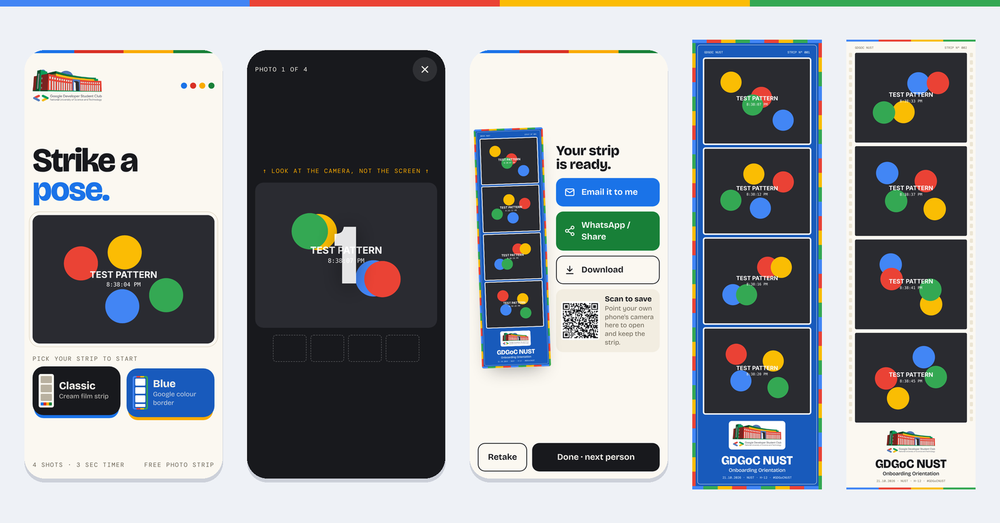

</div>

---

## Contents

- [Features](#features)
- [How it works](#how-it-works)
- [Screenshots](#screenshots)
- [Tech stack](#tech-stack)
- [Project structure](#project-structure)
- [Setup](#setup)
- [Deployment](#deployment)
- [Running the booth on event day](#running-the-booth-on-event-day)
- [Free-tier limits](#free-tier-limits)
- [Privacy](#privacy)
- [Credits](#credits)

## Features

| | |
|---|---|
| **Two strip styles** | *Classic*, a cream film strip with sprocket holes, and *Blue*, with a Google-colour border and white photo mats. Attendees pick one on the start screen and the session begins. |
| **Countdown and capture** | 4 photos (or 3) with a big on-screen countdown, beeps, a camera flash and live thumbnails. |
| **Branded output** | A 1080 px wide JPEG strip with the club logo, event name, date, venue, hashtag and a running strip number. |
| **Scan to save** | The strip is uploaded and shown as a QR code. Attendees scan it with their own phone and keep the full-resolution image. |
| **Email delivery** | Attendees type their address and receive a branded welcome email containing their strip. |
| **Share and download** | Native share sheet (WhatsApp and others) and download, as backups. |
| **Built for shared phones** | One-tap start, a clean reset after every person, auto-reset after 90 s of inactivity, no personal data stored on the device. |
| **Survives bad Wi-Fi** | Emails that fail to send are queued on the phone and retried automatically when the connection returns. |
| **Portrait and landscape** | Dedicated layouts for phones held either way, plus tablets and laptops. |
| **Installable** | Add to Home Screen for a fullscreen, address-bar-free kiosk. The app shell works offline. |
| **Operator panel** | A hidden settings panel for photo count, timer, camera, sound and a test pattern, opened by holding the four coloured dots. |

## How it works

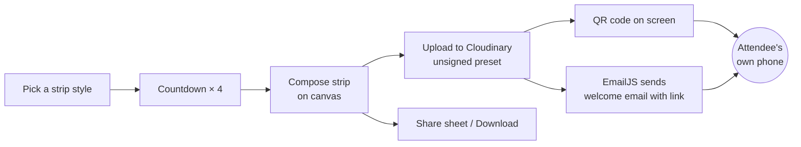

Everything runs in the browser. The camera is read with `getUserMedia`, the strip is drawn on a `<canvas>`, and the finished JPEG is uploaded directly from the phone to Cloudinary. EmailJS's free plan does not allow attachments and caps each request at 50 KB, so the email carries the hosted image link rather than the file itself. The same link powers the QR code.

## Screenshots

<table>
  <tr>
    <td align="center">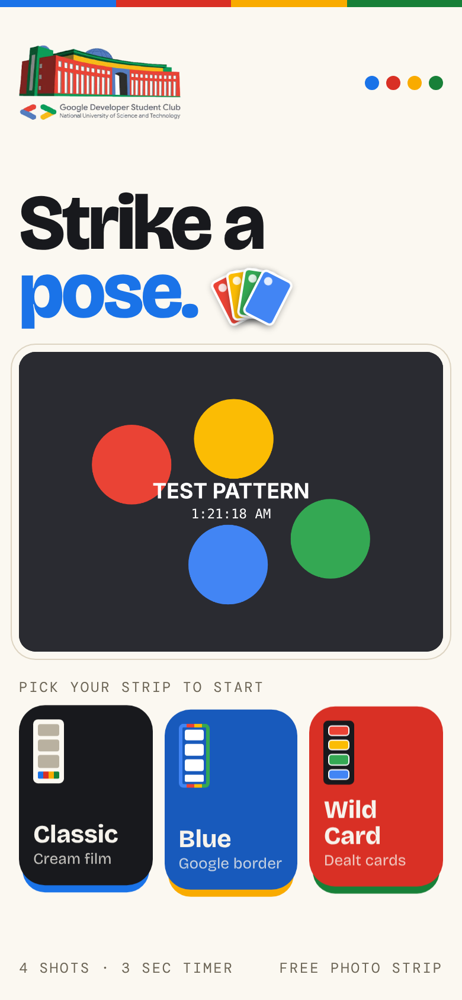<br><sub>Start screen</sub></td>
    <td align="center">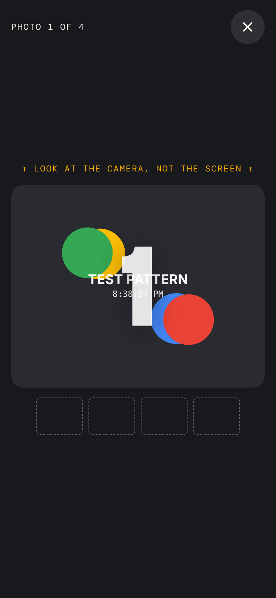<br><sub>Countdown</sub></td>
    <td align="center">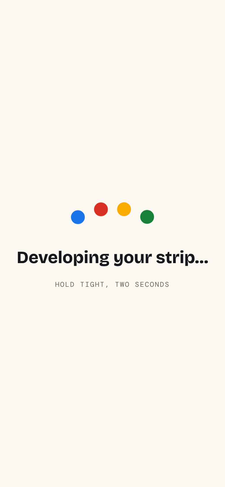<br><sub>Developing</sub></td>
    <td align="center">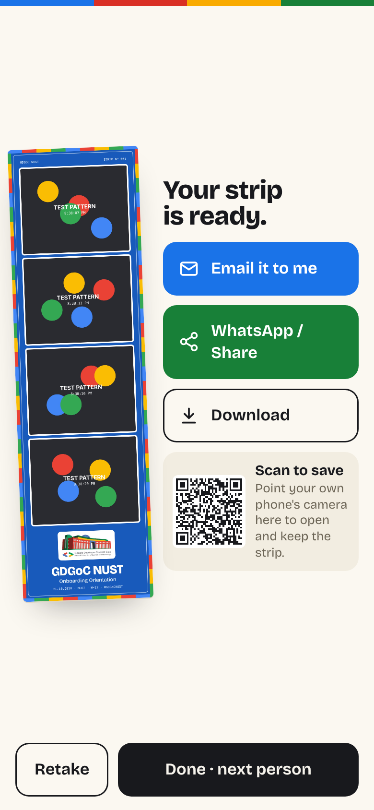<br><sub>Result with QR code</sub></td>
  </tr>
  <tr>
    <td align="center">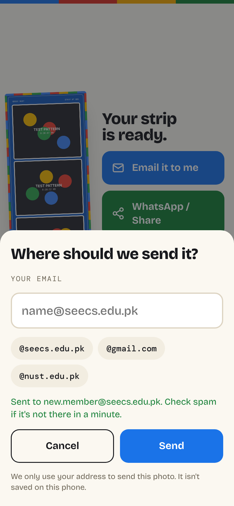<br><sub>Email sent</sub></td>
    <td align="center">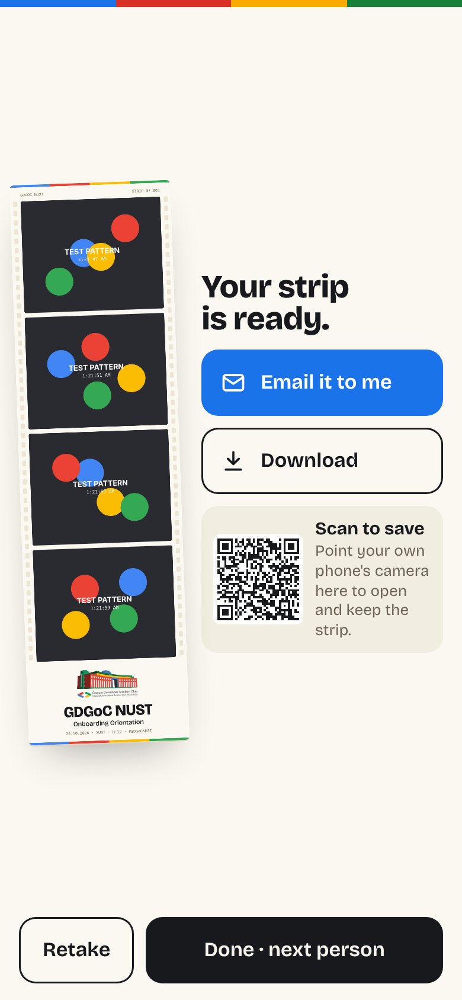<br><sub>Classic strip result</sub></td>
    <td align="center">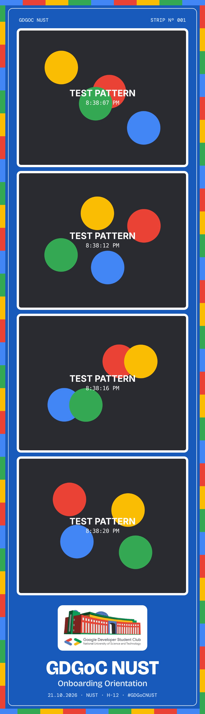<br><sub>Blue strip</sub></td>
    <td align="center">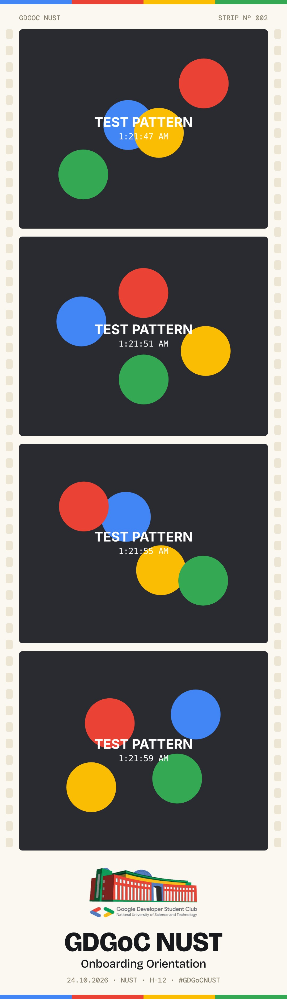<br><sub>Classic strip</sub></td>
  </tr>
</table>

<table>
  <tr>
    <td align="center">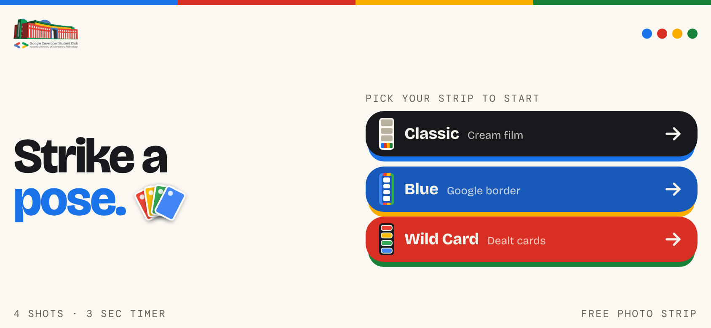<br><sub>Landscape start</sub></td>
    <td align="center">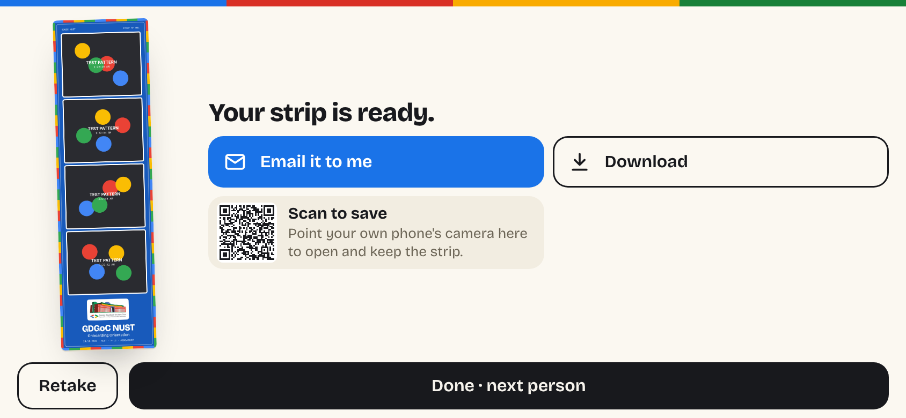<br><sub>Landscape result</sub></td>
  </tr>
  <tr>
    <td align="center" colspan="2">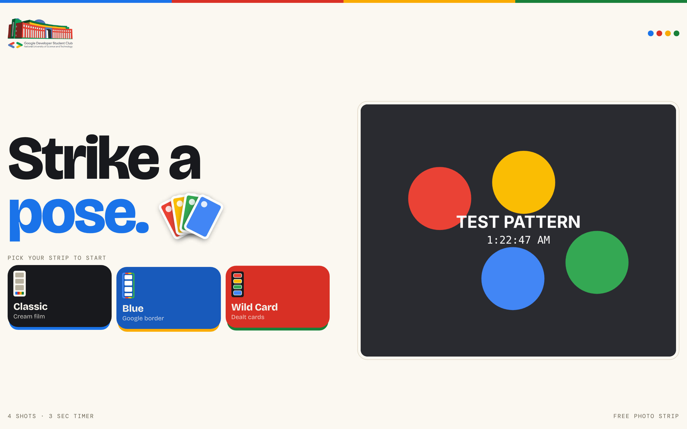<br><sub>Laptop or tablet: live camera preview on the right</sub></td>
  </tr>
</table>

<sub>Screenshots use the app's built-in test pattern instead of a real camera feed.</sub>

## Tech stack

- **HTML, CSS and vanilla JavaScript.** One file, no framework, no build step.
- **Canvas 2D** for cropping photos and composing the strip.
- **MediaDevices API** for the camera, **Web Share API** for sharing, **Wake Lock API** to keep the screen on.
- **IndexedDB** for the offline email queue.
- **Service worker and web app manifest** for install and offline support.
- **[Cloudinary](https://cloudinary.com)** (free tier) for image hosting through an unsigned upload preset.
- **[EmailJS](https://www.emailjs.com)** (free tier) for sending email from the browser.
- **[qrcode-generator](https://github.com/kazuhikoarase/qrcode-generator)** for QR codes, bundled locally.
- Fonts: Bricolage Grotesque and DM Mono, from Google Fonts.

## Project structure

```
.
├── index.html             # The whole app. Branding and keys live in CONFIG at the top of the script
├── brand/
│   └── logo.png           # Club logo (transparent PNG) used on the strip and start screen
├── qrcode.js              # QR code generator (MIT), bundled so it works offline
├── sw.js                  # Service worker: offline app shell
├── manifest.webmanifest   # Install-to-home-screen metadata
├── icon-192.png
├── icon-512.png
├── email-template.html    # Paste into EmailJS as the email body
├── vercel.json            # Camera permission header (Vercel only)
└── docs/                  # README images
```

## Setup

All configuration lives in the `CONFIG` object at the top of the script in `index.html`.

```js
const CONFIG = {
  eventName: "GDGoC NUST",
  eventSub: "Onboarding Orientation",
  eventPlace: "NUST · H-12",
  hashtag: "#GDGoCNUST",
  logo: "brand/logo.png",
  shots: 4,
  countdown: 3,
  cloudinary: { cloudName: "…", uploadPreset: "…", folder: "gdgoc-photobooth" },
  emailjs: [{ publicKey: "…", serviceId: "…", templateId: "…" }],
};
```

If either Cloudinary or EmailJS is left blank, the app runs in **demo mode**: a red tag appears and email and QR are disabled. Everything else still works.

### 1. Cloudinary (image hosting)

1. Create a free account at [cloudinary.com](https://cloudinary.com) and copy your **cloud name** from the dashboard.
2. Go to **Settings → Upload → Upload presets → Add upload preset**.
   - Signing mode: **Unsigned**
   - Folder: `gdgoc-photobooth`
   - Optional hardening: allowed formats `jpg`, max file size `3000000`
3. Put the cloud name and preset name in `CONFIG.cloudinary`.

### 2. EmailJS (email delivery)

1. Create a free account at [emailjs.com](https://www.emailjs.com).
2. **Email Services → Add New Service → Gmail**, and connect the club's Gmail account.
3. **Email Templates → Create New Template**:
   - **To Email:** `{{to_email}}`
   - **Subject:** `Welcome to GDGoC NUST! Here's your photo strip 📸`
   - **Content:** switch to code view and paste `email-template.html`
4. Copy the **Service ID**, **Template ID** and **Public Key** (Account → General) into `CONFIG.emailjs`.

Template variables sent by the app: `to_email`, `strip_url`, `download_url`, `event_name`, `event_sub`, `hashtag`.

> **Need more than 200 emails?** Create a second free EmailJS account and add it as a second entry in `CONFIG.emailjs`. The app spreads sends across accounts and falls through to the next one if one fails.

### 3. Run locally

The camera only works on `https://` or `localhost`.

```bash
npx serve .
# or
python3 -m http.server 8000
```

Then open `http://localhost:8000`. To test on a phone, deploy it (below), because phones reach your laptop over plain HTTP, which blocks the camera.

## Deployment

This is a static site. Any static host with HTTPS works.

### Vercel (recommended)

1. Push this repository to GitHub.
2. Go to [vercel.com](https://vercel.com), sign in with GitHub, then **Add New → Project → Import** this repository.
3. Framework preset: **Other**. Leave the build command and output directory empty. Click **Deploy**.
4. You get a URL like `gdgoc-photobooth.vercel.app`. Every push to `main` redeploys automatically.

### GitHub Pages

1. In the repository, go to **Settings → Pages**.
2. Source: **Deploy from a branch**, Branch: `main`, Folder: `/ (root)` → **Save**.
3. After a minute or two the site is live at `https://<username>.github.io/<repo>/`.

GitHub Pages is free for public repositories. `vercel.json` is ignored there, which is fine.

> After changing app files, bump `VERSION` in `sw.js` so installed phones pick up the update.

## Running the booth on event day

**The day before**
- [ ] Open the live URL on each booth phone. In the browser menu, choose **Add to Home Screen**, then launch from the icon.
- [ ] Allow camera access once. On iPhone, also set Settings → Safari → Camera → **Allow**.
- [ ] Take a test strip: confirm the QR code appears and an email arrives.
- [ ] Do a dry run with three or four people.

**At the booth**
- [ ] Lock the phone into the app: iPhone **Guided Access** (Settings → Accessibility), Android **App pinning**.
- [ ] Turn auto-lock off and brightness up, and keep chargers plugged in.
- [ ] Use a stable hotspot. If it drops, emails queue and send when it's back.

**Operator panel.** Hold the four coloured dots on the start screen for 1.5 s.

| Setting | Options |
|---|---|
| Photos per strip | 3 · 4 |
| Countdown | 3 s · 5 s · 10 s |
| Camera | Front · Back |
| Beeps | On · Off |
| Test pattern | Replaces the camera, for testing |
| Unsent emails | Shows the offline queue, with a manual retry |

## Free-tier limits

| Service | Free allowance | Used for |
|---|---|---|
| EmailJS | 200 emails/month per account, no attachments, 50 KB per request | Email delivery |
| Cloudinary | Monthly credit allowance (≈ 25 GB storage/bandwidth) | Hosting strips, QR links |
| Vercel / GitHub Pages | Generous static hosting | The app itself |

A strip is about 150–250 KB, so Cloudinary comfortably covers thousands of strips. The QR code has no per-use limit, which makes it the best channel for a busy event.

## Privacy

- Email addresses are used only to send the strip. They are never stored on the booth phone, except briefly in the offline queue until the email is sent.
- Strips are stored in the club's Cloudinary account under unguessable URLs. Delete the `gdgoc-photobooth` folder after the event if you prefer.
- No analytics, cookies or tracking.

## Credits

Built by **Waasila Asif**, Tech Lead, GDGoC NUST.

QR codes by [qrcode-generator](https://github.com/kazuhikoarase/qrcode-generator) (MIT, Kazuhiko Arase). Google Developer Groups branding belongs to Google; this is a community project of GDGoC NUST.
