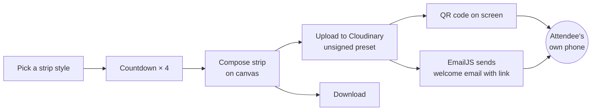
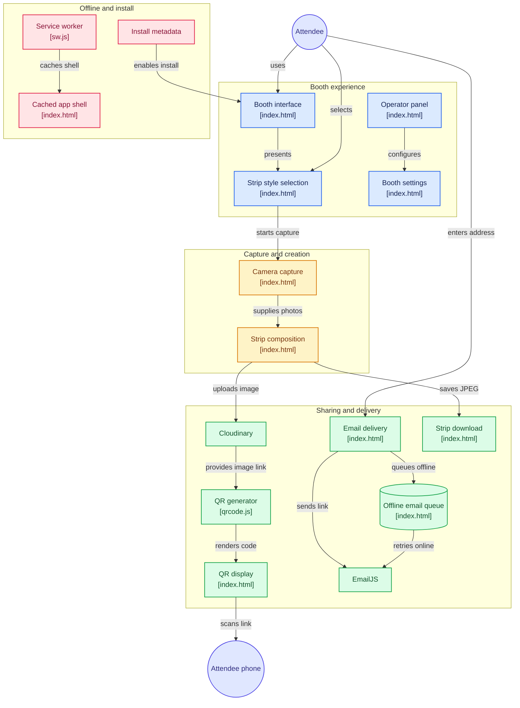
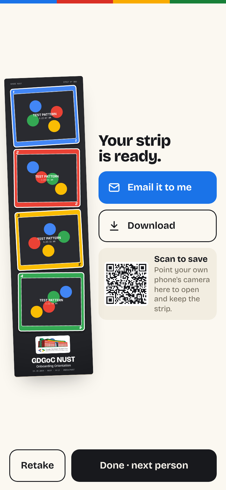
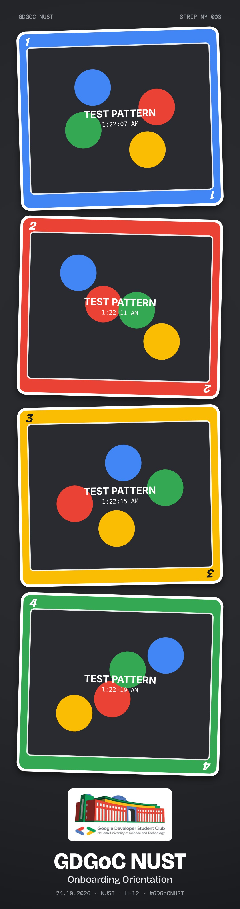

<div align="center">

# GDGoC NUST Photobooth

**A free, phone-based photobooth for the GDGoC NUST Onboarding Orientation.**
Four photos, a countdown, a branded photo strip, and three ways to take it home. No backend, no app install, no cost.
>Try it for yourself [Live Link](https://gdg-photobooth.vercel.app/)

---


[](https://opensource.org/licenses/MIT)
[](https://gitdiagram.com/waasilaasif/gdg-photobooth?utm_source=readme&utm_medium=badge)


</div>

---

## Contents

- [Features](#features)
- [How it works](#how-it-works)
- [Screenshots](#screenshots)
- [Tech stack](#tech-stack)
- [Project structure](#project-structure)
- [Setup](#setup)
- [Customising the strips](#customising-the-strips)
- [Deployment](#deployment)
- [Running the booth on event day](#running-the-booth-on-event-day)
- [Keys and security](#keys-and-security)
- [Free-tier limits](#free-tier-limits)
- [Privacy](#privacy)
- [Credits](#credits)

## Features

| | |
|---|---|
| **Three strip styles** | *Classic*: a cream film strip with sprocket holes. *Blue*: a Google-colour border with white photo mats. *Wild Card*: each photo dealt as a coloured playing card on a dark card table. Attendees tap a style and the session starts. |
| **Countdown and capture** | 4 photos (or 3) with a big on-screen countdown, beeps, a camera flash and live thumbnails. |
| **Branded output** | A 1080 px wide JPEG strip with the club logo, event name, date, venue, hashtag and a running strip number. |
| **Scan to save** | The strip is uploaded and shown as a QR code. Attendees scan it with their own phone and keep the full-resolution image. |
| **Email delivery** | Attendees type their address and receive a branded welcome email containing their strip. |
| **Download** | Saves the strip to the booth phone as a backup. |
| **Built for shared phones** | One-tap start, a clean reset after every person, auto-reset after 90 s of inactivity, no personal data kept on the device. |
| **Survives bad Wi-Fi** | Emails tapped while offline are queued on the phone and sent once the connection returns. Each email is tried at most twice, so nobody gets spammed. |
| **Portrait and landscape** | Dedicated layouts for phones held either way, plus tablets and laptops. |
| **Installable** | Add to Home Screen for a fullscreen, address-bar-free kiosk. The app shell works offline. |
| **Operator panel** | A hidden settings panel for photo count, timer, camera, sound and a test pattern, opened by holding the four coloured dots. |

## How it works



Everything runs in the browser. The camera is read with `getUserMedia`, the strip is drawn on a `<canvas>`, and the finished JPEG is uploaded straight from the phone to Cloudinary. EmailJS's free plan does not allow attachments and caps each request at 50 KB, so the email carries the hosted image link rather than the file itself. The same link powers the QR code.

---




---

## Screenshots

<table>
  <tr>
    <td align="center"><br><sub>Start screen</sub></td>
    <td align="center"><br><sub>Countdown</sub></td>
    <td align="center"><br><sub>Developing</sub></td>
    <td align="center"><br><sub>Result with QR code</sub></td>
  </tr>
  <tr>
    <td align="center"><br><sub>Email sent</sub></td>
    <td align="center"><br><sub>Wild Card result</sub></td>
    <td align="center"><br><sub>Classic result</sub></td>
    <td></td>
  </tr>
  <tr>
    <td align="center"><br><sub>Wild Card strip</sub></td>
    <td align="center"><br><sub>Blue strip</sub></td>
    <td align="center"><br><sub>Classic strip</sub></td>
    <td></td>
  </tr>
</table>

<table>
  <tr>
    <td align="center"><br><sub>Landscape start</sub></td>
    <td align="center"><br><sub>Landscape result</sub></td>
  </tr>
  <tr>
    <td align="center" colspan="2"><br><sub>Laptop or tablet: live camera preview on the right</sub></td>
  </tr>
</table>

<sub>Screenshots use the app's built-in test pattern instead of a real camera feed.</sub>

## Tech stack

- **HTML, CSS and vanilla JavaScript.** One file, no framework, no build step.
- **Canvas 2D** for cropping photos and composing the strip.
- **MediaDevices API** for the camera, **Wake Lock API** to keep the screen on.
- **IndexedDB** for the offline email queue.
- **Service worker and web app manifest** for install and offline support.
- **[Cloudinary](https://cloudinary.com)** (free tier) for image hosting through an unsigned upload preset.
- **[EmailJS](https://www.emailjs.com)** (free tier) for sending email from the browser.
- **[qrcode-generator](https://github.com/kazuhikoarase/qrcode-generator)** for QR codes, bundled locally.
- Fonts: Bricolage Grotesque and DM Mono, from Google Fonts.

## Project structure

```
.
├── index.html             # The whole app. Branding and keys live in CONFIG at the top of the script
├── brand/
│   └── logo.png           # Club logo (transparent PNG) used on the strips and start screen
├── qrcode.js              # QR code generator (MIT), bundled so it works offline
├── sw.js                  # Service worker: offline app shell
├── manifest.webmanifest   # Install-to-home-screen metadata
├── icon-192.png
├── icon-512.png
├── email-template.html    # Paste into EmailJS as the email body
├── vercel.json            # Camera permission header (Vercel only)
└── docs/                  # README images
```

## Setup

All configuration lives in the `CONFIG` object at the top of the script in `index.html`.

```js
const CONFIG = {
  eventName: "GDGoC NUST",
  eventSub: "Onboarding Orientation",
  eventPlace: "NUST · H-12",
  hashtag: "#GDGoCNUST",
  logo: "brand/logo.png",
  shots: 4,
  countdown: 3,
  cloudinary: { cloudName: "…", uploadPreset: "…", folder: "gdgoc-photobooth" },
  emailjs: [{ publicKey: "…", serviceId: "…", templateId: "…" }],
};
```

If either Cloudinary or EmailJS is left blank, the app runs in **demo mode**: a red tag appears, and email and QR are disabled. Everything else still works.

### 1. Cloudinary (image hosting)

1. Create a free account at [cloudinary.com](https://cloudinary.com) and copy your **cloud name** from the dashboard.
2. Go to **Settings → Upload → Upload presets → Add upload preset**.
   - Signing mode: **Unsigned**
   - Folder: `gdgoc-photobooth`
   - Recommended: allowed formats `jpg`, max file size `3000000`
3. Put the cloud name and preset name in `CONFIG.cloudinary`.

### 2. EmailJS (email delivery)

1. Create a free account at [emailjs.com](https://www.emailjs.com).
2. **Email Services → Add New Service → Gmail.** Connect the account and **tick "Send email on your behalf"** on Google's permission screen.
   > Use a **dedicated Gmail account** for the booth (e.g. `gdgocnust.photobooth@gmail.com`). University-managed Google Workspace accounts often block third-party senders, which shows up as a `412 Gmail_API` error.
3. **Email Templates → Create New Template**:
   - **To Email:** `{{to_email}}`
   - **From Name:** `GDGoC NUST`
   - **Reply To:** the society's official address
   - **Subject:** `Welcome to GDGoC NUST! Here's your photo strip 📸`
   - **Content:** switch to code view and paste `email-template.html`
4. Copy the **Service ID**, **Template ID** and **Public Key** (Account → General) into `CONFIG.emailjs`.

Template variables sent by the app: `to_email`, `strip_url`, `download_url`, `event_name`, `event_sub`, `hashtag`.

> **Need more than 200 emails?** Create a second free EmailJS account and add it as a second entry in `CONFIG.emailjs`. The app spreads sends across accounts and falls through to the next one if one fails.

To switch to a different service or template later, just change the `serviceId` / `templateId` values. Keep the quotes and commas.

### 3. Run locally

The camera only works on `https://` or `localhost`.

```bash
npx serve .
# or
python3 -m http.server 8000
```

Open `http://localhost:8000`. To test on a phone, deploy it (below), because a phone reaches your laptop over plain HTTP, which blocks the camera.

## Customising the strips

All strip drawing is in `index.html`:

| What you want to change | Where |
|---|---|
| Event name, subtitle, venue, hashtag, logo | `CONFIG` |
| Colours (paper, ink, Blue background, card table, Google colours) | `CONFIG.colors` |
| Per-style spacing, borders, mats, text colours, logo card | `STRIP_STYLES` (`classic`, `blue`, `cards`) |
| Layout, border pattern, card drawing, footer text positions | `function drawStrip` |
| The little strip icons on the start-screen buttons | CSS: `.sw-classic`, `.sw-blue`, `.sw-cards` |

To add a new style, add an entry to `STRIP_STYLES`, add a button with a matching `data-style` to the picker, and handle any special drawing in `drawStrip`.

**After any change, bump `VERSION` in `sw.js`** (e.g. `pb-v3` → `pb-v4`) so installed phones pick up the update. Test with the test pattern: hold the four dots → Test pattern **On** → take a strip.

> If you remove a button from the HTML, also remove its `$("#…").onclick` line in the script. A handler pointing at a missing element throws an error and stops the rest of the app from loading.

## Deployment

This is a static site. Any static host with HTTPS works.

**Operator panel.** Hold the four coloured dots on the start screen for 1.5 s.

| Setting | Options |
|---|---|
| Photos per strip | 3 · 4 |
| Countdown | 3 s · 5 s · 10 s |
| Camera | Front · Back |
| Beeps | On · Off |
| Test pattern | Replaces the camera, for testing |
| Unsent emails | Shows the offline queue, with a manual retry |

## Free-tier limits

| Service | Free allowance | Used for |
|---|---|---|
| EmailJS | 200 emails/month per account, no attachments, 50 KB per request | Email delivery |
| Cloudinary | Monthly credit allowance (≈ 25 GB storage/bandwidth) | Hosting strips, QR links |
| Vercel / GitHub Pages | Generous static hosting | The app itself |

A strip is about 150–250 KB, so Cloudinary comfortably covers thousands of strips. The QR code has no per-use limit, which makes it the best channel for a busy event.

## Privacy

- Email addresses are used only to send the strip. They are never stored on the booth phone, except briefly in the offline queue until the email is sent (at most 3 hours).
- Strips are stored in the club's Cloudinary account under unguessable URLs. Delete the `gdgoc-photobooth` folder after the event if you prefer.
- No analytics, cookies or tracking.

## Credits

Built by **Waasila Asif**, Tech Lead, GDGoC NUST.

QR codes by [qrcode-generator](https://github.com/kazuhikoarase/qrcode-generator) (MIT, Kazuhiko Arase). Google Developer Groups branding belongs to Google; this is a community project of GDGoC NUST. The Wild Card style is an original card-game design.